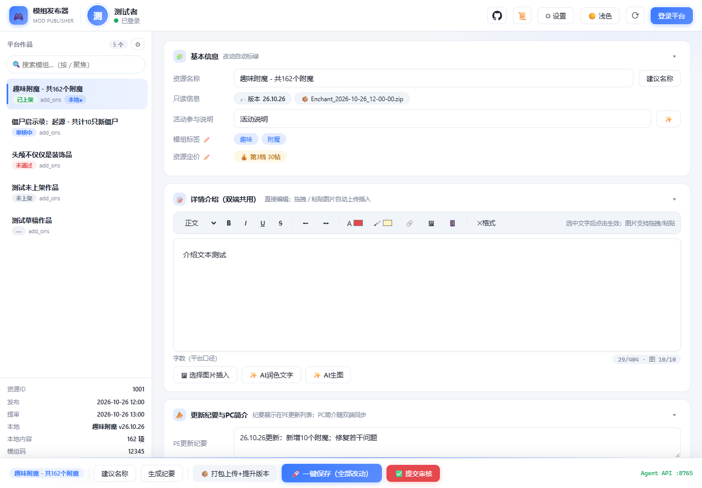
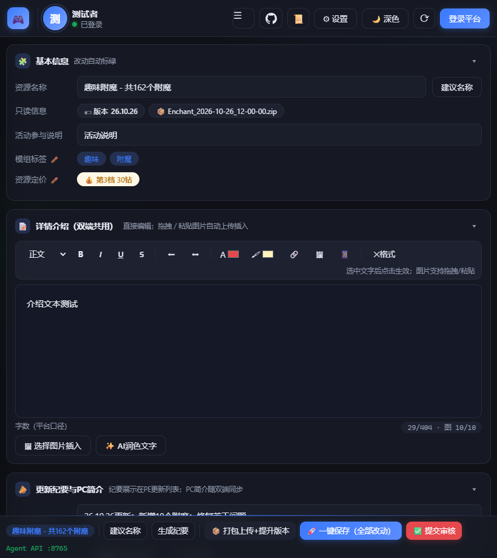
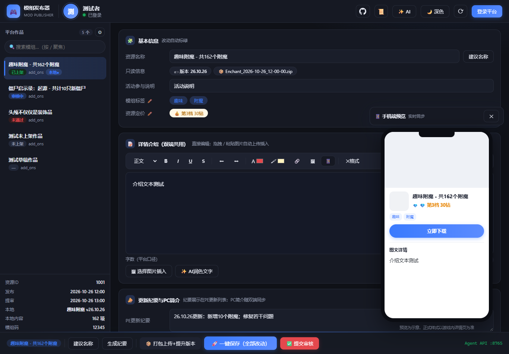
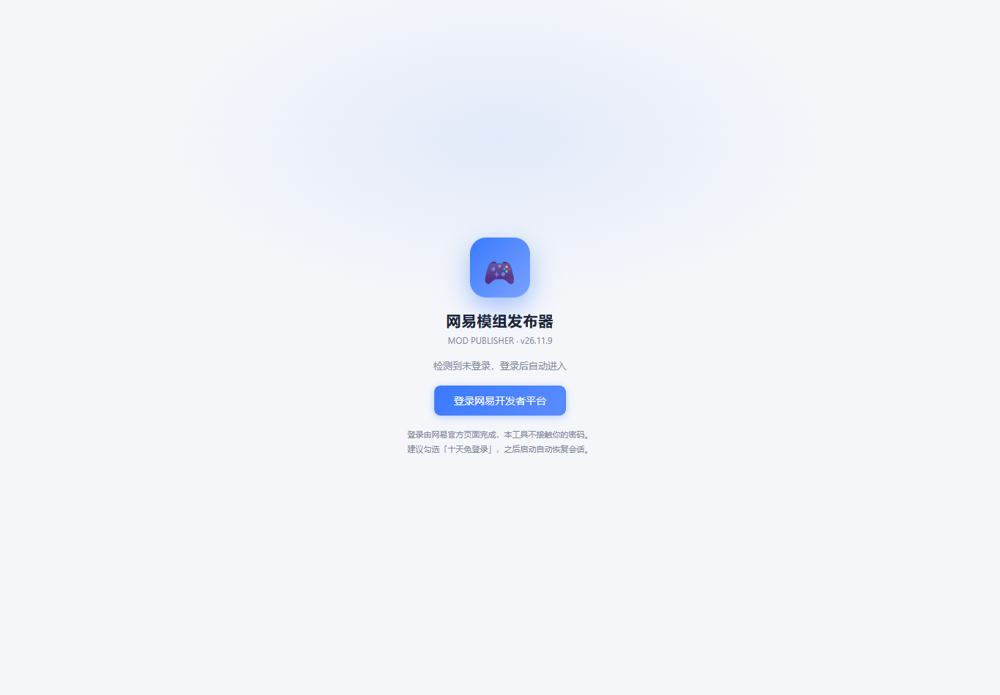

<div align="center">

# 🎮 网易模组发布器

**把「更新模组 → 打包 → 上传 → 填表 → 提审」压缩成几次点击**

一个面向网易《我的世界》开发者平台的桌面效率工具：平台接口直连、
富文本详情编辑、图片/视频槽位直传、AI 润色与生图、Agent MCP 接入、
手机端远程管理——全部内置在一个 exe 里。


**[⬇ 下载最新版](https://github.com/InvisibleGuardian007/ModPublisher/releases/latest)** ·
内置热更新，之后的版本在应用里一键升级，无需再手动下载

</div>

> ⚠️ 本工具仅操作开发者本人账号下的作品；提审等不可逆动作均需人工确认。
> 界面与平台接口均为自制实现，与网易官方无关。

| 主界面（明 / 暗主题） | 手机端远程管理 |
|---|---|
|  |  |
| **商店式详情预览 + AI 生图** | **内置登录门** |
|  |  |

---

## ✨ 功能亮点

**🖥 主界面**

- 双击 exe → 品牌登录页 → 登录自动进入（会话约十天免登录，过期自动引导重登）
- 作品列表 / 搜索 / 状态彩色标签 / 本地映射标记 / **「本地版本领先，可发布」提示**
- 点选作品**秒读**全部表单（平台 165 字段），改动自动标绿，没改的字段提交平台原值
- **详情编辑器**：富文本直接编辑，拖拽 / 粘贴图片自动上传，⛶ 全屏模式，
  字数预算计数器与平台同口径（404 字 / 10 图，超限拦截——平台超限是静默吞图）
- **图片槽位**：组件 ICON、手机位×6、PC 位×2，拖入即传；**视频**：mp4 + 封面即时预览
- **手机端预览**：📱 在手机壳里实时预览网易商店详情页（封面 / 定价 / 标签 / 图文）
- **卡片折叠**、运行日志抽屉（分级配色）、⚙ 设置集中配置、深浅主题跟随系统
- **布局自适应**：宽屏双栏 → 窄窗抽屉 → 手机单列，底栏自动折叠次要操作

**🤖 AI 助手**（⚙ 设置填任意 OpenAI 兼容接口：DeepSeek / 智谱 / Moonshot / OpenAI…）

- **润色全覆盖**：PE 纪要（≤200 字）/ PC 简介 / 活动说明 / 详情文字（≤360 字防截断）/ 全字段逐项 ✨
- **AI 生图**：描述画面 → 生成 → 插入详情或应用到槽位（自动上传平台）；API 可与润色共用

**📦 发布自动化**

| 官方手工步骤 | 本工具 |
|---|---|
| 手动打包（压缩双包目录） | 自动：扫描 `*_behavior_pack` / `*_resource_pack` 合并压缩，排除 `__pycache__`/`.pyc` |
| 手动改 manifest 版本 | 自动：版本号 = 当天日期 `[yy,m,d]`，全部 uuid 重生成（防身份碰撞） |
| 删除旧 zip | 自动清理旧时间戳包 |
| 网页大文件上传 | 接口直传（fp.ps.netease.com），带进度；大文件走独立通道 |
| 分块表单逐项保存 | 一次 `update` 提交全部改动 + 回读验证（平台静默截断/包替换失败会被抓住） |
| 手动提审 | 确认后自动提交 |

**⬇ 热更新**

- 启动静默检查更新，有新版 ⚙ 亮红点；设置里「立即更新」→ 下载（带进度）→
  SHA256 校验 → 自动换文件重启，失败自动回滚

---

## 🚀 快速开始

```
1. 下载 release 里的 exe，双击运行
2. 登录网易开发者平台（建议勾选「十天免登录」）
3. ⚙ 设置：配置本地项目映射与 AI 接口（可选）
4. 选择作品 → 编辑 → 一键保存 → 提交审核
```

**📱 手机端**：同一局域网手机浏览器打开「⚙ 设置」里显示的
`http://<ip>:8765/ui?token=…`，即可远程管理——读改字段、传图、打包发布，
日志与打包进度实时推送到手机。

---

## 🤖 Agent 接入

**MCP（推荐）**——在任意支持 MCP 的客户端里加一段配置，Agent 即可直驱发布器：

```json
{
  "mcpServers": {
    "netease-mod-publisher": {
      "command": "D:/path/to/网易模组发布器.exe",
      "args": ["--mcp"]
    }
  }
}
```

工具：`list_works / read_item / set_fields / set_pc_detail / add_image /
publish / submit_review / open_official`（发布器未运行时自动拉起）

**CLI / HTTP**（本机）：

```bash
网易模组发布器.exe --cmd list
网易模组发布器.exe --cmd read "趣味附魔 - 共162个附魔"
网易模组发布器.exe --cmd set "作品名" --json "{\"item_name\":\"新名称\"}"
网易模组发布器.exe --cmd publish "作品名" --note "26.11.9更新：…" --submit
```

`POST http://127.0.0.1:8765 /list /read /set /set-pc /add-image /publish /submit`

---

## 🛠 构建

依赖：Python 3.12+、系统 Edge（无需下载浏览器内核）。

```bash
py -3 -m pip install playwright requests
py -3 -m PyInstaller --noconfirm 网易模组发布器.spec
# 或从源码直接跑：启动发布器.bat
```

---

## 📁 项目结构

| 文件 | 说明 |
|---|---|
| `mod_publisher.py` | 宿主：引擎线程、页面 RPC、Agent HTTP/MCP、AI、热更新、发布编排 |
| `ui.html` | 界面（设计系统、脏值跟踪、文档编辑器、手机预览、响应式） |
| `publish_api.py` | 平台接口（停靠页 fetch 传输 / 直传 / update 构造 / 本地打包） |
| `publish_core.py` | 浏览器引擎（登录 / 兜底自动化） |
| `tests/e2e_v12.py` | 真会话端到端回归 |
| `tests/ui_smoke.py` | 离线 UI 冒烟（桩 RPC，127 项） |
| `tests/test_update_body.py` | 离线单测：update body 变更通用应用 |
| `tests/test_detail_recipe.py` | 离线单测：详情组装配方 |
| `tests/do_publish.py` | 趣味附魔发布脚本（`--dry-run` 只读自检） |

---

## ⚙️ 实现备忘

<details>
<summary>端点与实现细节（点开查看）</summary>

- API host：`mc-launcher.webapp.163.com`（列表带尾斜杠；detail/update/apply_review 不带）
- 上传：`filepicker/file_token` 取 token（Policy 内含实际上传地址）→
  `fp.ps.netease.com` multipart 直传 → 响应 JSON + `x-ntes-signature` 头；
  >32MB 大文件优先 `ctx.request` 通道，免 base64 过 CDP
- update 请求体 = detail 原样透传 + 字段矫正（mc_version 字符串转数组等）+
  **changes 通用应用**（字符串脏值按原字段类型适配回 list/dict/bool/int）
- 详情字数：编辑器按 Quill 长度计（**图片占 1 字**），PE 详情上限 404 字、图片≤10 张；
  富文本白名单 `p/strong/span/br/img`（`<b>` 报非法字符，发布前自动矫正）
- 发布护栏：详情预检 + 字数/图数校验（超限**直接报错不发布**）、
  update 后回读验证（详情被截断/包未替换立即报错）
- 鉴权为轮换票据：所有请求经常驻平台域的停靠页 `fetch` 发出，
  由浏览器原生管理 cookie 轮换（静态导出 cookie 会被轮换挤掉失效）
- 热更新：下载 Release 资产 → SHA256 校验 → 「改名旧 exe→移入新 exe→重启」，
  证书校验失败（代理环境）自动回退系统证书栈

</details>

## ⚠️ 已知限制

- 仅支持 PE（add_ons，含双端同步）类资源；皮肤/联机商品页结构不同未支持
- 模组攻略为平台独立文章系统，本工具只读展示
- 平台改版导致接口失效时自动回退浏览器自动化流程并记录日志
- 手机端需与电脑同一局域网；首次启动 Windows 防火墙可能弹一次放行

## 📄 免责声明

仅供个人开发效率用途，请遵守《网易MC开发者协议》及相关平台规则；
自动化仅限本人账号低频操作，提交审核永远需要人工确认。
